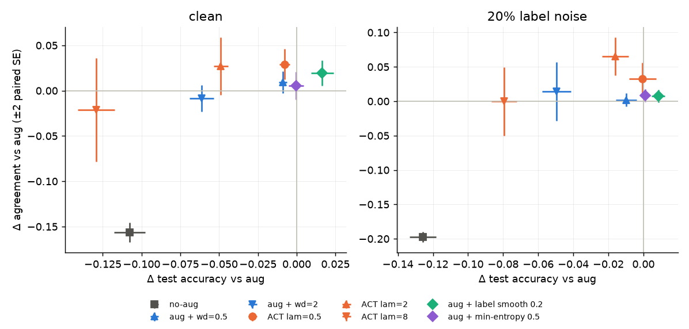
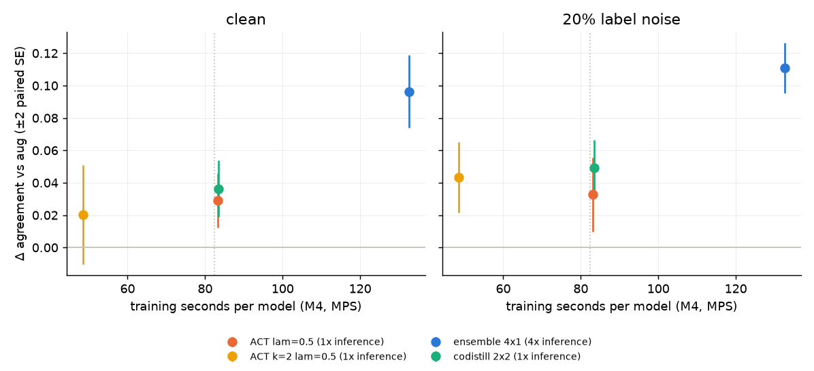

## Augmentation-Consistency Training

Turney (1995) argued that a good learner should produce essentially the same concept when trained on two independent samples from the same distribution. Stability here means **agreement**: train two models on disjoint samples and count how often they give the same label on new data. The machine-learning literature calls the opposite quantity **prediction churn**.

**Augmentation-Consistency Training (ACT)** runs each minibatch through the network as k randomly augmented views and adds a penalty for the views disagreeing:

```python
def act_loss(model, x, y, k=4, lam=0.5):
    logits = [model(augment(x)) for _ in range(k)]     # random crop + flip
    ce = mean(cross_entropy(z, y) for z in logits)
    penalty = mean(symmetric_kl(softmax(z_i), softmax(z_j)) for i < j)
    return ce + lam * penalty
```

**Bottom line.** ACT is one option for reducing churn, not a replacement for the others. On CIFAR-10 with 2,000 images per model, it raises agreement between independently trained models by **+3 points with no accuracy loss under label noise, and by +3 points at −0.8 points of accuracy on clean labels**. It is a single model trained in a single run, with no second network and no extra cost at prediction time. Among the methods with that cost profile it gives up the least accuracy for its agreement gain. Co-distillation buys somewhat more agreement for more accuracy, and an ensemble buys much more agreement for 4× the prediction cost. The test is narrow: one small CNN, one dataset size, 5 trials. The loss itself is not new (see Novelty).

### Choosing a churn reducer

Paired change against `aug` (4 augmented views, cross-entropy only), mean over 5 trials, in percentage points. The ± values are paired SEs and are in the tables further down.

| Method | Prediction cost | Training | Clean Δacc / Δagree | Noisy Δacc / Δagree |
|---|---|---|---|---|
| label smoothing 0.2 | 1× | 1 model, 4 views | **+1.6** / +1.9 | +0.8 / +0.8 |
| ACT λ=0.5 | 1× | 1 model, 4 views | −0.8 / +2.9 | −0.0 / +3.3 |
| ACT λ=2 | 1× | 1 model, 4 views | −4.9 / +2.7 | −1.6 / +6.6 |
| ACT λ=0.5, k=2 | 1× | 1 model, 2 views (58% of the time) | −2.2 / +2.0 | −1.2 / +4.3 |
| co-distillation | 1× | 2 models trained jointly, 2 views each | −2.3 / +3.6 | −0.6 / +4.9 |
| ensemble of 4 | 4× | 4 models, 1 view each | −0.2 / **+9.6** | +0.1 / **+11.1** |

How to read it:
- **If you can pay several forward passes per prediction, average an ensemble.** Nothing at 1× comes close: it roughly triples the agreement gain of every other row and costs no accuracy.
- **If you need one model and accuracy comes first, use label smoothing.** It is the only row that raises accuracy. Its agreement gain on clean labels is all explained by that accuracy gain, and it does little under label noise.
- **If you need one model and want agreement at little accuracy cost, use ACT λ=0.5.** This is ACT's niche, and it is clearest with noisy labels (+3.3 agreement, no accuracy change). It is also the simplest of the 1× options to add: one extra loss term, no second network to train or hold in memory.
- **If you need one model and will trade more accuracy for more agreement, use co-distillation or ACT with a larger λ.** Co-distillation agrees 0.7 points more than ACT λ=0.5 on clean labels (not significant) and 1.6 ± 0.6 more under noise, at 0.6 to 1.6 points less accuracy. Under noise, ACT λ=2 gives a larger agreement gain than co-distillation at a larger accuracy cost. These two rows were not compared head to head.
- **ACT and the other single-model methods can be combined.** That was not tested here. Label smoothing + ACT and co-distillation + ACT are the obvious next arms.

One cost difference this experiment cannot show: co-distillation trains two networks at once, so it holds two copies of the weights and optimizer state. With this small CNN that is a few MB. For a large network it would roughly double training memory, while ACT's extra memory is only the activations of the additional views. That is an inference from how the methods work, not a measurement.

### Why you'd expect this (the mechanism)

- **Agreement measures variance.** Two models trained on independent samples disagree on an input only when the learned function varies from sample to sample. That is the variance term of the bias–variance decomposition. Any regularizer that shrinks this variance raises agreement, so the right test is not "does ACT raise agreement?" but "does it raise agreement more than other regularizers at the same accuracy?" That is the *frontier* comparison used below.
- **For small augmentations the penalty is a gradient penalty.** Write a view as x + δ with small δ. Then KL(p(x+δ) ‖ p(x)) ≈ ½ δᵀ J(x)ᵀ F J(x) δ, where J is the Jacobian of the logits and F is the softmax Fisher matrix. Averaged over augmentations, this penalizes how fast the prediction changes along the directions the augmentations move. Bishop (1995) showed the same for training with noise: it is Tikhonov regularization.
- **So ACT can beat generic regularizers only through the directions it penalizes.** Weight decay shrinks the function's sensitivity in every direction. ACT shrinks it only along crops and flips, which are directions the label genuinely does not depend on. Constraining the function where the truth is known to be flat costs less accuracy than constraining it everywhere. This is the condition under which ACT should beat the frontier. [`experiments/dct`](experiments/dct) is the control: the same loss with dropout masks in place of augmentations. Dropout noise carries no information about the data, and there the method lands exactly on the frontier.
- **Why label noise should help ACT more.** A flipped label pulls the model to change its prediction near one training image. Averaging cross-entropy over views does not stop that. The consistency term, however, penalizes a prediction that changes sharply in that neighbourhood, so the model fits the flipped label less and both halves fall back on what the clean images say.

### Design

- **Data:** CIFAR-10. In each of 5 trials, 4,000 training images are drawn and split into two disjoint halves of 2,000. In the *20% label noise* condition, 20% of the labels are flipped to a uniformly chosen other class. Every arm sees the same pools, so differences are paired by trial. Both models of a pair are scored on the full **10,000-image test set with clean labels**.
- **Network:** the original notebook's small CNN (4 conv layers, dropout), AdamW, 30 epochs, batch 64.
- **Augmentation:** the standard CIFAR crop (reflect-pad 4, random 32×32 crop) and horizontal flip. A grid of real augmented views was inspected.
- **Arms.** All arms except `no-aug` use k = 4 views per batch, so they have the same compute and the same data.

| Arm | What it is |
|---|---|
| `no-aug` | one view and no augmentation: the original notebook's baseline |
| `aug` | 4 augmented views, cross-entropy only. **This is the reference arm.** |
| `aug + wd=0.5`, `aug + wd=2` | plus AdamW weight decay (generic regularization) |
| `aug + label smooth 0.2` | plus label smoothing, the basis of Bahri & Jiang's (2021) churn method |
| `aug + min-entropy 0.5` | plus a penalty on prediction entropy, the churn regularizer of Bhojanapalli et al. (2021) |
| `ACT lam=0.5/2/8` | plus λ · symmetric KL between views |

- **Metrics:**
  - `agree`: the share of test images where the two models predict the same class.
  - `excess_agree`: agreement above what the two accuracies would give if the models erred independently.
  - `soft_agree`: the old metric, exp(−symmetric KL).
  - `confidence`: the mean top predicted probability.

  Hard agreement depends only on the argmax, so flattening the probabilities cannot change it. The soft metric can be moved that way.

### Results

Paired change against `aug`, as mean ± SE over 5 trials:

| | Clean Δacc | Clean Δagree | Noisy Δacc | Noisy Δagree |
|---|---|---|---|---|
| `no-aug` (original baseline) | −0.108 ± .005 | −0.157 ± .005 | −0.126 ± .004 | −0.198 ± .004 |
| `aug + wd=0.5` | −0.009 ± .001 | +0.009 ± .006 | −0.010 ± .003 | +0.002 ± .005 |
| `aug + wd=2` | −0.061 ± .004 | −0.008 ± .007 | −0.049 ± .004 | +0.014 ± .021 |
| `aug + label smooth 0.2` | **+0.016 ± .004** | +0.019 ± .007 | +0.008 ± .002 | +0.008 ± .005 |
| `aug + min-entropy 0.5` | −0.000 ± .002 | +0.005 ± .008 | +0.001 ± .001 | +0.008 ± .005 |
| **`ACT lam=0.5`** | −0.008 ± .002 | **+0.029 ± .008** | −0.000 ± .004 | **+0.033 ± .011** |
| `ACT lam=2` | −0.049 ± .002 | +0.027 ± .016 | −0.016 ± .004 | **+0.066 ± .014** |
| `ACT lam=8` | −0.129 ± .006 | −0.021 ± .029 | −0.080 ± .004 | −0.000 ± .025 |

The full table, including excess agreement, soft agreement and confidence, is in `results/paired_vs_aug.csv`.



Head-to-head paired contrasts at comparable accuracy:

| Contrast | Clean Δacc | Clean Δagree | Noisy Δacc | Noisy Δagree |
|---|---|---|---|---|
| ACT 0.5 − wd 0.5 | +0.001 ± .002 | +0.020 ± .008 | +0.009 ± .003 | +0.031 ± .010 |
| ACT 2 − wd 2 | +0.013 ± .006 | +0.036 ± .016 | +0.034 ± .003 | +0.051 ± .012 |
| ACT 0.5 − min-entropy | −0.007 ± .003 | +0.023 ± .004 | −0.001 ± .005 | +0.024 ± .007 |
| ACT 0.5 − label smooth | −0.024 ± .004 | +0.010 ± .005 | −0.009 ± .003 | +0.025 ± .011 |

What the tables show:

1. **ACT beats weight decay outright.** At the same strength it gives equal or higher accuracy *and* 2 to 5 points more agreement. It moves the model up and to the right of the weight-decay frontier, not along it. This is the outcome the mechanism predicts for a regularizer that encodes real invariances.
2. **Under label noise it beats the churn literature's regularizers too.** ACT λ=0.5 matches their accuracy to within one point and agrees 2.4 to 2.5 points more. ACT λ=2 doubles the agreement gain (+6.6 points) for 1.6 points of accuracy.
3. **On clean labels, label smoothing is the honest competitor.** It is the only arm that improves accuracy (+1.6 points), and its agreement gain is fully explained by that improvement: excess agreement is +0.002. ACT λ=0.5 gives 1 point more agreement at 2.4 points less accuracy. Neither dominates, and which is better depends on the price of churn relative to errors. The two can also be combined, which was not tested.
4. **The minimum-entropy regularizer does nothing here.** It moves confidence up and changes neither accuracy nor agreement.
5. **λ = 8 is too strong.** Most of the consistency gain comes from λ ≤ 2.
6. **The original comparison mostly measured augmentation.** Going from `no-aug` to `aug` is worth 16 to 20 points of agreement and 11 to 13 points of accuracy, five times more than the consistency term adds on top.
7. **The soft metric again tracks confidence.** Label smoothing and weight decay raise it by 0.06 to 0.19 just by flattening the probabilities. Minimum entropy *lowers* it, even though its hard agreement is unchanged.

**What this result rests on:**
- One architecture, one sample size, one augmentation family, 5 trials.
- The comparators are swept at only one or two strengths each. A finer label-smoothing sweep, or label smoothing combined with weight decay, might close the gap on clean data.
- Agreement is measured between two models' argmax predictions. The conclusion about churn does not depend on calibration.

### Compute: does ACT win on cost?

Measured against the two standard ways to cut churn:
- **Ensembles** cut churn but cost m× at prediction time.
- **Co-distillation** (Anil et al. 2018; Bhojanapalli et al. 2021) costs one model at prediction time.

All arms below make 4 forward passes per training step, like `aug` and `ACT`, except `ACT k=2`, which makes 2. The win criterion was fixed before running: ACT should reach at least half of the ensemble's agreement gain at a quarter of the inference cost, *and* beat co-distillation on agreement at matched accuracy.

Paired change vs `aug` (5 trials), with mean training time and memory per model:

| Arm | Inference | Train s | Clean Δacc | Clean Δagree | Noisy Δacc | Noisy Δagree |
|---|---|---|---|---|---|---|
| `ACT lam=0.5` (k=4) | 1× | 83 | −0.008 | +0.029 ± .008 | −0.000 | +0.033 ± .011 |
| `ACT k=2 lam=0.5` | 1× | 49 | −0.022 | +0.020 ± .015 | −0.012 | +0.043 ± .011 |
| co-distillation, 2 models × 2 views | 1× | 84 | −0.023 | +0.036 ± .009 | −0.006 | +0.049 ± .009 |
| ensemble of 4, 1 view each | 4× | 133 | −0.002 | **+0.096 ± .011** | +0.001 | **+0.111 ± .008** |



**The criterion was not met, so ACT does not dominate on cost; it is one point on the trade-off.**
- ACT gets 30% of the ensemble's agreement gain in both conditions, at a quarter of the prediction cost. The 50% bar was a round number chosen in advance, not derived.
- Co-distillation agrees more than ACT at the same training and inference cost: +0.7 points clean (not significant) and +1.6 ± 0.6 under noise. ACT is 0.6 to 1.6 points more accurate.

ACT and co-distillation therefore sit on the same trade-off between accuracy and agreement, with ACT at the more accurate end. Two smaller observations:
- Halving the views (`k=2`) keeps most of ACT's agreement gain in 58% of the training time, at some cost in clean accuracy.
- Training memory differs by only a few MB between arms with this small CNN. Measured as MPS driver allocation after `empty_cache()`, it doesn't separate the methods.

The ensemble trains slower in wall-clock than the others at equal forward passes, because it runs four sequential single-view models. Rows are in `results/compute.csv` and the paired table in `results/compute_paired.csv`.

### Novelty

- **The training loss is not new.**
  - AugMix (Hendrycks et al., ICLR 2020) trains supervised image classifiers with cross-entropy plus a Jensen–Shannon consistency loss across three augmented views. That is ACT with a different divergence.
  - The Π-model (Laine & Aila 2017; Sajjadi et al. 2016) and UDA (Xie et al. 2020) use the same penalty for semi-supervised learning.
  - The k > 2 pairwise generalization and the symmetric KL are routine variations.
- **The churn literature has not, as far as I found, tested augmentation consistency.**
  - Bhojanapalli et al. (2021) list augmentation as a *source* of churn and reduce churn with minimum-entropy regularizers and co-distillation.
  - Bahri & Jiang (2021) use adaptive label smoothing.
  - Milani Fard et al. (2016) anchor a new model to an old one.
  - A search for consistency regularization evaluated as a churn reducer turned up nothing. Note that their churn is mostly across random seeds on the same data, while the agreement here is across disjoint samples (Turney's version).
- **What could be a contribution:** "consistency regularization over label-preserving augmentations reduces cross-sample churn more than the standard churn regularizers do, especially with noisy labels", together with the mechanism above that says *when*: only when the augmentations encode true invariances (contrast [`experiments/dct`](experiments/dct)). That is a modest empirical claim. Before calling it established it needs:
  - a standard ResNet with full training;
  - several sample sizes, plus a second dataset;
  - a finer sweep of label smoothing, plus label smoothing + ACT;
  - co-distillation as a comparator. It has now been run (see Compute above): it matches or beats ACT on agreement and ACT is more accurate, so the claim narrows to "an option at the accurate end of the 1× trade-off".

### What was wrong before

- **Every vision result was measured on training data.** The test set was "indices not used in either half", but the halves used all of them. The code then fell back to `indices[:300]`, which are model 1's own training images.
- **The baseline had no augmentation and a quarter of the compute.** It ran one unaugmented pass, against ACT's four augmented passes. So the claimed stability gain mixed augmentation with consistency. Augmentation alone turns out to be worth five times more.
- **The README's numbers don't match the notebook's.** For example, the README reports 0.419 ± 0.034 where the notebook prints ± 0.065. The ± values were SDs over a few trials, not paired.
- **The code used one-directional KL**, while the README describes and shows symmetric KL.
- **The augmentations included a 90° rotation for CIFAR**, which is not label-preserving in practice: an upside-down horse is out of distribution. They also included additive noise on every view.
- **Noisy-label accuracy was scored against the corrupted labels.**
- **Negative tabular results were dropped from the README.** The notebook's bootstrap-consistency experiments on tabular data hurt both stability and accuracy and were not mentioned.
- **The "novel" framing ignored the closest prior art.** It omitted AugMix's supervised multi-view consistency loss and the churn literature that already measures this kind of stability.

### Reproduce

```
uv sync
make experiment   # CIFAR-10 via Hugging Face datasets; results/runs.csv; ~3 h on an M4 (MPS)
make figures      # results/paired_vs_aug.csv, frontier.png, compute_paired.csv, compute.png
uv run python experiment.py --extra   # compute comparison -> results/compute.csv; ~2 h on an M4
make dct          # the dropout control in experiments/dct; ~20 min on 6 cores
make ci           # black, isort, flake8, pytest
```

Each run is cached by `joblib.Memory` in `cache/`, so an interrupted experiment resumes where it stopped.

### References

- Turney, P. (1995). Bias and the quantification of stability. *Machine Learning* 20: 23–33.
- Bishop, C. (1995). Training with noise is equivalent to Tikhonov regularization. *Neural Computation* 7(1).
- Hendrycks, D. et al. (2020). [AugMix](https://arxiv.org/abs/1912.02781). *ICLR*.
- Sajjadi, M., Javanmardi, M. & Tasdizen, T. (2016). Regularization with stochastic transformations and perturbations for deep semi-supervised learning. *NeurIPS*.
- Laine, S. & Aila, T. (2017). Temporal ensembling for semi-supervised learning. *ICLR*.
- Xie, Q. et al. (2020). Unsupervised data augmentation for consistency training. *NeurIPS*.
- Milani Fard, M. et al. (2016). Launch and iterate: reducing prediction churn. *NeurIPS*.
- Anil, R. et al. (2018). [Large scale distributed neural network training through online distillation](https://arxiv.org/abs/1804.03235). *ICLR*.
- Bhojanapalli, S. et al. (2021). [On the reproducibility of neural network predictions](https://arxiv.org/abs/2102.03349).
- Bahri, D. & Jiang, H. (2021). [Locally adaptive label smoothing for predictive churn](https://arxiv.org/abs/2102.05140). *ICML*.
