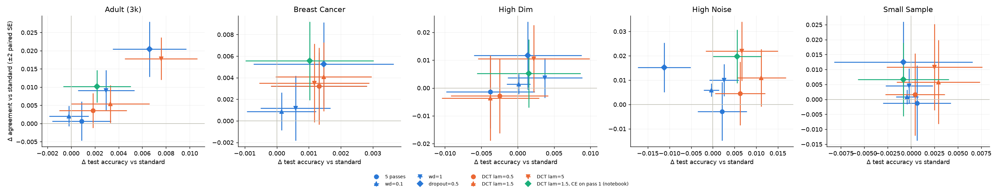

## Dropout-Consistency Training (control for ACT)

This is the control experiment for ACT (see the [top-level README](../../README.md)): the same consistency loss, with the noise coming from dropout masks instead of data augmentations. Its negative result is what ACT's mechanism predicts for noise that encodes no invariance of the data.

Turney (1995) argued that a good learner should produce essentially the same concept when trained on two independent samples from the same distribution. He measured this *stability* as **agreement**: train two models on separate samples and count how often they give the same label on new data. The machine-learning literature now calls the opposite quantity **prediction churn**.

**Dropout-Consistency Training (DCT)** tries to build stability into a single model. Each minibatch is run through the network n times, each time with a different random dropout mask. The loss is the cross-entropy plus a penalty on how much those n predictions disagree:

```python
def dct_loss(model, x, y, n_passes=5, lam=1.5):
    logits = [model(x) for _ in range(n_passes)]                  # dropout on
    ce = mean(cross_entropy(z, y) for z in logits)
    penalty = mean(mse(softmax(z_i), softmax(z_j)) for i < j)
    return ce + lam * penalty
```

**Bottom line.** DCT does make independently trained models agree a little more: +0.4 to +2.2 points of agreement. But **simply raising the dropout rate from 0.3 to 0.5 buys the same amount**, with one forward pass instead of five. DCT never beats ordinary regularization on the stability–accuracy trade-off. The large stability gains the earlier version of this README reported came from a metric that rewards low confidence, plus a results table that was a placeholder.

### Why you'd expect this (the mechanism)

- **The penalty is the variance of the predictions across dropout masks.** The average squared difference between two independent draws of anything is twice its variance. So the pairwise penalty is 2·Var_mask(p(x)). Fraternal dropout (Zolna et al. 2018) proves the same identity, and `test_pairwise_mse_is_twice_variance_across_masks` checks it numerically.
- **For a linear layer, that variance is a weighted ridge penalty.** With dropout rate q, the logit's variance across masks is q/(1−q)·Σⱼ wⱼ²xⱼ². That's an L2 penalty on the weights, weighted by the data (Wager, Wang & Liang 2013); `test_linear_dropout_variance_is_weighted_ridge` checks it.
- **So DCT is a regularizer, not a new source of stability.** Agreement between models trained on different samples measures how much the fit varies from sample to sample, which is the variance term in the bias–variance decomposition. Any regularizer lowers that. Dropout noise is generated inside the model and carries no information about the data, unlike augmentations that encode true invariances. There is no reason to expect DCT to do better than other regularizers at equal accuracy.

The experiment tests exactly that.

### Design

- **Data:** the notebook's three synthetic datasets (High Noise, Small Sample, High Dim), plus Breast Cancer and a 3,000-row sample of UCI Adult. The old README claimed Adult results; the notebook never ran Adult.
- **Splits:** 20 trials. Each holds out 30% as a test set and splits the rest into two disjoint halves. Each half trains one model, with its own standardization, and the pair is scored on the test set. Every arm sees the same splits, so differences are paired by trial.
- **Arms:**

| Arm | What it is |
|---|---|
| `standard` | the notebook's MLP: dropout 0.3, one pass |
| `5 passes` | five dropout passes with cross-entropy averaged and no penalty: DCT's compute, without the penalty |
| `DCT lam=0.5/1.5/5` | the README's loss, cross-entropy averaged over passes |
| `DCT lam=1.5, CE on pass 1` | the notebook's variant: cross-entropy on the first pass only |
| `wd=0.1`, `wd=1`, `dropout=0.5` | ordinary regularizers, which trace out the comparison frontier |

- **Metrics:**
  - `agree`: the share of test points where the two models give the same label.
  - `excess_agree`: agreement above what the two accuracies would produce if their errors were independent.
  - `soft_agree`: the old metric, exp(−symmetric KL).
  - `confidence`: the mean top predicted probability.

### Results

Paired change against `standard`, as mean ± SE over 20 trials:

| Dataset | | Δ accuracy | Δ agreement | Δ soft agreement (old metric) | Δ confidence |
|---|---|---|---|---|---|
| Adult | DCT λ=5 | +0.008 ± .002 | +0.018 ± .003 | −0.011 | +0.002 |
| | **dropout 0.5** | +0.007 ± .002 | **+0.020 ± .004** | +0.113 | −0.019 |
| High Noise | DCT λ=5 | +0.007 ± .004 | +0.022 ± .006 | +0.038 | −0.021 |
| | dropout 0.5 | −0.011 ± .003 | +0.015 ± .005 | +0.090 | −0.052 |
| Small Sample | DCT λ=5 | +0.002 ± .003 | +0.011 ± .007 | +0.020 | −0.008 |
| | dropout 0.5 | −0.001 ± .004 | +0.013 ± .007 | +0.068 | −0.028 |
| High Dim | DCT λ=5 | +0.002 ± .004 | +0.011 ± .006 | −0.038 | +0.006 |
| | dropout 0.5 | +0.001 ± .004 | +0.012 ± .006 | +0.183 | −0.044 |
| Breast Cancer | DCT λ=5 | +0.001 ± .001 | +0.004 ± .002 | −0.014 | +0.002 |
| | dropout 0.5 | +0.001 ± .001 | +0.005 ± .002 | +0.024 | −0.001 |

The notebook's variant, `DCT lam=1.5, CE on pass 1`, lands in the same place: +0.005 to +0.020 agreement. The full table is in `results/paired_vs_standard.csv`.



What the table shows:

1. **On hard agreement, DCT sits on the regularization frontier.** Its best setting and a one-line change to the dropout rate give the same gain on every dataset. The one partial exception is High Noise, where DCT keeps accuracy (+0.007) and higher dropout loses a little (−0.011). The intervals overlap, though, so this is suggestive at most.
2. **The old "soft agreement" metric mostly measures under-confidence.** Weight decay of 1 and dropout of 0.5 raise it by +0.03 to +0.18 just by flattening the predicted probabilities: confidence falls by 0.02 to 0.05. The five-pass arms *raise* confidence and so *lower* soft agreement. Hard agreement doesn't have this confound.
3. **Running five passes without the penalty does nothing** (Δ agreement ≈ 0). Whatever DCT does comes from the penalty, as expected.

### Novelty

- **The method is fraternal dropout (Zolna et al., ICLR 2018) with n > 2 passes.** Fraternal dropout uses an L2 penalty on pre-softmax outputs; R-Drop (Wang et al. 2021) uses KL. Multiple consistency passes and a choice of distance function are routine variations.
- **The evaluation target is not new either.** Measuring stability as agreement between independently trained models is the "prediction churn" problem: Milani Fard et al. (2016), Bhojanapalli et al. (2021), Bahri & Jiang (2021). That literature already reduces churn with entropy regularization, co-distillation and locally adaptive label smoothing, which are the right comparisons for any churn claim.
- **What would be a contribution:** showing that a churn-reduction method beats the regularization frontier on real benchmarks. DCT does not do that here.

### What was wrong before

- **The results table was a placeholder.** The README reported IMDB, CIFAR-10, Adult and MIMIC-II numbers, then said "*Numbers are illustrative; plug in the latest run when available.*" The notebook only ran four small tabular datasets.
- **The README described a different comparison from the one the code ran.** It said model A (standard) and model D (DCT) were trained on the two halves and compared with each other. The code compared two models trained with the same method, which is the correct design.
- **The metric, exp(−symmetric KL), rewards low confidence.** There was no hard-label agreement, no accuracy-adjusted agreement, and no matched-compute or regularization baseline.
- **The README's loss and the notebook's loss differ.** The README averages cross-entropy over passes; the notebook uses the first pass only. Both are now tested.
- **Uncertainty was reported as a ± SD over 6 trials, not paired.**

### Reproduce

From the repository root:

```
uv sync
make dct    # results/<dataset>.csv, paired_vs_standard.csv and frontier.png in experiments/dct; ~20 min on 6 cores
make ci     # black, isort, flake8, pytest (includes this experiment's tests)
```

### References

- Turney, P. (1995). Bias and the quantification of stability. *Machine Learning* 20: 23–33.
- Zolna, K., Arpit, D., Suhubdy, D. & Bengio, Y. (2018). [Fraternal dropout](https://arxiv.org/abs/1711.00066). *ICLR*.
- Wang et al. (2021). R-Drop: Regularized dropout for neural networks. *NeurIPS*.
- Wager, S., Wang, S. & Liang, P. (2013). Dropout training as adaptive regularization. *NeurIPS*.
- Milani Fard, M. et al. (2016). [Launch and iterate: reducing prediction churn](https://papers.nips.cc/paper/2016/file/dc5c768b5dc76a084531934b34601977-Reviews.html). *NeurIPS*.
- Bhojanapalli, S. et al. (2021). [On the reproducibility of neural network predictions](https://arxiv.org/abs/2102.03349).
- Bahri, D. & Jiang, H. (2021). [Locally adaptive label smoothing for predictive churn](https://arxiv.org/abs/2102.05140). *ICML*.
